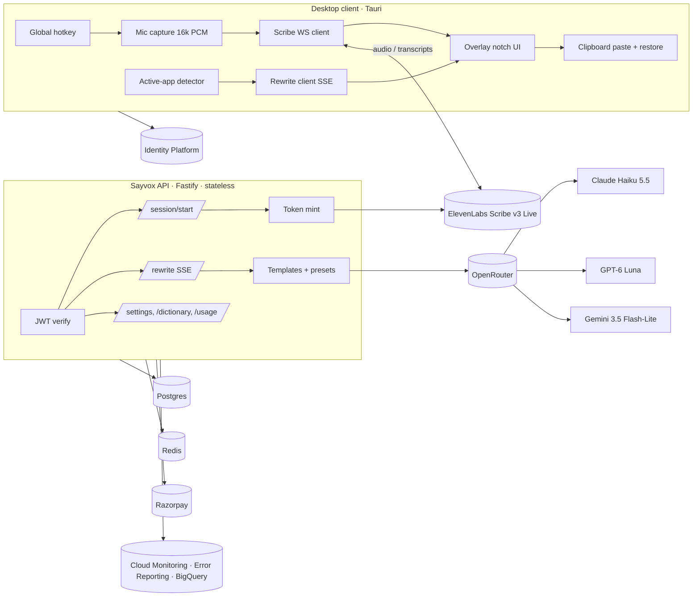
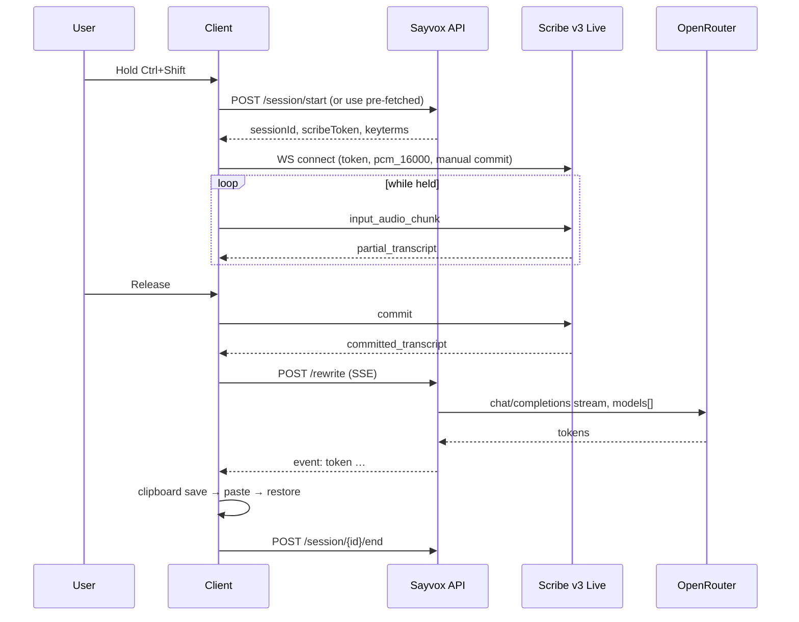

# Sayvox Architecture Document

> BMAD artifact · Architect output · v1.0 · 2026-11-24
> Inputs: `docs/prd.md`, `docs/front-end-spec.md`, source architecture (2026-11-23)

## 1. Introduction

This document defines the full-stack architecture for Sayvox: a Tauri desktop client, a stateless TypeScript backend, and managed services (ElevenLabs Scribe v3 Live, OpenRouter, Razorpay), with all hosted infrastructure on Google Cloud (ADR-006). It is the single source of truth for AI-driven development agents.

> **LLM provider:** OpenRouter ([ADR-008](adr/ADR-008-llm-gateway.md)). Vertex AI is not used.
> **Decisions in force:** [docs/adr/](adr/README.md).

**Starter template:** none (greenfield). Tauri v2 `create-tauri-app` (Vite + TypeScript) for the client; Fastify scaffold for the API.

### Change Log
| Date | Version | Description | Author |
| --- | --- | --- | --- |
| 2026-11-24 | 1.0 | Initial architecture | Architect (BMAD) |

## 2. High-Level Architecture

### Technical Summary
Audio flows **client → ElevenLabs** directly using a single-use token minted by the backend; only text flows through Sayvox's backend. The backend is a stateless REST + SSE modular monolith that authenticates users, mints Scribe tokens, enforces quotas in Redis, selects prompt templates and model presets, relays streamed OpenRouter output, and records metadata-only session rows in Postgres.

### Platform & Infrastructure
All on Google Cloud (ADR-006):
- **API:** Cloud Run in `us-east4`, min 2 instances; autoscale on CPU + concurrent requests; images in Artifact Registry.
- **DB:** Cloud SQL for PostgreSQL 16, automated daily backups + PITR; Cloud SQL connector from Cloud Run; app-side pooling.
- **Cache:** Memorystore for Redis 7 via Direct VPC egress.
- **Edge:** External Application Load Balancer + Cloud Armor (TLS, DDoS, WAF rules, rate limiting).
- **Web/downloads:** Firebase Hosting for the website; installers and update manifests in Cloud Storage behind Cloud CDN.
- **Jobs:** Cloud Scheduler → Cloud Run jobs (session sweeper, weekly usage reconciliation).

### Repository Structure
Monorepo with pnpm workspaces + Turborepo; Rust crate inside the Tauri app.

### Architecture Diagram



### Architectural Patterns
- **Direct-to-provider streaming with brokered credentials:** keeps audio bandwidth off the backend and secrets off the client.
- **Stateless modular monolith:** one deployable, horizontal scale, modules by domain (auth, session, rewrite, settings, billing, usage).
- **Config-driven model routing:** presets, model slugs and templates are server config — changeable without a client release.
- **Graceful degradation:** retry → fallback model → raw transcript.
- **Privacy by default:** text processed in memory only; metadata persisted.

## 3. Tech Stack

| Category | Technology | Version (pin at init) | Purpose / Rationale |
| --- | --- | --- | --- |
| Desktop shell | Tauri | 2.x | Small installers, fast start, Rust core for hotkeys/audio/clipboard |
| Client core | Rust | stable (1.8x) | Hotkey hook, `cpal` audio capture, `enigo`/native paste, active-window detection |
| Client UI | TypeScript + Vite + Solid/React | TS 5.x | Overlay and settings UI |
| Backend language | TypeScript (Node.js) | Node 22 LTS | Shared types with client |
| Backend framework | Fastify | 5.x | Fast, low-overhead, native SSE support via reply.raw |
| Validation | Zod (+ fastify-type-provider-zod) | 3.x | Shared request/response schemas |
| ORM / SQL | Drizzle ORM | latest | Typed SQL, migrations |
| Database | Postgres | 16 | Users, plans, settings, sessions, usage |
| Cache / limits | Redis | 7 | Rate limits, quotas, settings cache, kill switch |
| Auth | Google Identity Platform (Firebase Auth) | — | Accounts; ID token (JWT) verified via Google JWKS |
| STT | ElevenLabs Scribe v3 Live | — | Realtime WS transcription |
| LLM gateway | OpenRouter | — | One API/bill, `models` fallback list |
| HTTP client | undici | 6.x | Keep-alive pool to OpenRouter |
| Billing | Razorpay Subscriptions | — | Plans + webhooks (ADR-003) |
| Errors | Google Cloud Error Reporting | — | Backend errors direct; client crashes via `POST /v1/telemetry` (scrubbed) |
| Analytics | Cloud Logging → BigQuery | — | Text-free product events via `POST /v1/telemetry` |
| Metrics | OpenTelemetry → Cloud Monitoring + Cloud Trace | — | Latency, fallback, spend dashboards and alerts |
| Tests (TS) | Vitest, Supertest/light-my-request | — | Unit/integration/contract |
| Tests (Rust) | cargo test | — | Client core |
| E2E | WebdriverIO + tauri-driver | — | Desktop smoke tests |
| CI/CD | GitHub Actions | — | Lint, test, eval, build, sign, deploy |
| IaC | Terraform (google provider) | — | Reproducible Google Cloud infra |

## 4. Data Models

### User
`id uuid PK, email text unique, auth_provider_id text unique, created_at timestamptz, plan_id fk→plans, status enum(active, suspended, deleted)`

### Plan
`id text PK (free|pro|team…), name, monthly_audio_minutes int, daily_cap_minutes int, allowed_presets text[], dictionary_limit int, price_cents int, currency`

### Subscription
`user_id fk, provider text default 'razorpay', provider_sub_id, status, current_period_end`

### Settings
`user_id PK/fk, preset enum(fastest, balanced, cheapest), default_mode enum(dictation, prompt, email), app_mode_overrides jsonb {appId: mode}, insert_mode enum(auto, review), language_hint text, hotkey text`

### DictionaryTerm
`id uuid, user_id fk, term text (≤ 64 chars), created_at` — unique (user_id, lower(term))

### Session
`id uuid, user_id, started_at, ended_at, mode, target_app, audio_seconds numeric, model_used, fallback_used bool, input_tokens, output_tokens, ttft_ms, total_ms, client_release_to_insert_ms, stt_commit_ms, status enum(started, completed, raw_fallback, failed, abandoned), client_version, region`

### UsageDaily
`user_id, day date, audio_seconds, requests, llm_cost_usd, stt_cost_usd` — PK (user_id, day)

**No table stores transcript or rewrite text.**

### Shared TypeScript interfaces (`packages/shared`)
```ts
export type Mode = "dictation" | "prompt" | "email";
export type Preset = "fastest" | "balanced" | "cheapest";
export interface SessionStartResponse {
  sessionId: string; scribeToken: string; keyterms: string[];
  maxSessionSeconds: number; languageHint?: string;
}
export interface RewriteRequest {
  sessionId: string; transcript: string; mode: Mode; targetApp: string;
  threadContext?: string; // email mode only, optional
}
export interface SessionEndRequest {
  audioSeconds: number; insertResult: "inserted" | "raw_fallback" | "discarded" | "failed";
  timings: { sttCommitMs: number; ttftMs?: number; releaseToInsertMs: number };
}
```

## 5. API Specification
Full OpenAPI: `specs/001-voice-to-prompt-mvp/contracts/openapi.yaml`.

| Method + path | Purpose | Notes |
| --- | --- | --- |
| `POST /v1/session/start` | Quota check, create session, mint Scribe token, return keyterms | < 150 ms; also used for pre-fetch |
| `POST /v1/rewrite` | Transcript + mode + app → SSE stream | Events: `meta`, `token`, `fallback`, `done`, `error` |
| `POST /v1/session/{id}/end` | Client timings + audio seconds | Closes row, updates `usage_daily` |
| `GET`/`PUT /v1/settings` | Read/update settings | Redis cache, 5 min TTL, bust on write |
| `GET`/`POST`/`DELETE /v1/dictionary` | Custom terms | Plan-capped |
| `GET /v1/usage` | Period usage + limits | |
| `GET /v1/client-config` | min client version, kill switch, rollout flags | Unauthenticated-safe subset |
| `POST /v1/billing/checkout` | Create checkout session | |
| `POST /v1/billing/webhook` | Provider events | Signature-verified, idempotent |
| `DELETE /v1/account` | Delete user + all rows | |
| `POST /v1/telemetry` | Client crash reports + text-free product events | Enum/number fields only; → Error Reporting / BigQuery |
| `GET /healthz` | Liveness | |

**Error envelope:** `{ "error": { "code": "QUOTA_EXCEEDED", "message": "...", "requestId": "..." } }`

## 6. Components

### Desktop client (`apps/desktop`)
| Module | Layer | Responsibility |
| --- | --- | --- |
| `hotkey` | Rust | Global hold detection (macOS CGEventTap / Windows `SetWindowsHookEx` low-level hook); emits `press`/`release` |
| `audio` | Rust | `cpal` capture, resample to 16 kHz mono i16, 100–250 ms chunks, ring buffer for retry |
| `active_app` | Rust | Frontmost app bundle id / exe name + window title |
| `insert` | Rust | Save clipboard → write text → synthesize Cmd/Ctrl+V → restore clipboard |
| `token_cache` | TS | Holds one pre-fetched session/token; refreshes after use or expiry |
| `scribe_client` | TS | WS lifecycle, chunk send, partial/committed handling, one retry |
| `rewrite_client` | TS | SSE consumer; first-token & total timers |
| `mode_resolver` | TS | default mode + per-app overrides → Mode |
| `overlay` | TS UI | State machine: hidden → listening → transcribing → rewriting → review? → inserted / error |
| `settings_ui` | TS UI | Settings, dictionary, usage, privacy, account |
| `updater` | Tauri plugin | Signed manifests, staged rollout, min-version enforcement |
| `telemetry` | TS | Crash reports and text-free events to `POST /v1/telemetry`; timings to `/session/end` |

### Backend (`apps/api`)
| Module | Responsibility |
| --- | --- |
| `auth` | Verify JWT via JWKS; map to `users` row (lazy create) |
| `limits` | Redis token-bucket rate limit; daily/monthly audio quotas; max session seconds |
| `session` | Create/close session rows; mint ElevenLabs single-use token |
| `rewrite` | Template + preset selection, OpenRouter streaming, 1.5 s TTFT deadline per attempt, SSE relay |
| `prompts` | Versioned templates from `packages/prompts` |
| `settings` / `dictionary` / `usage` | CRUD + caching |
| `billing` | Checkout + webhook → plan updates |
| `config` | Presets, model slugs, kill switch, min client version (env + Redis overrides) |
| `observability` | OTel traces/metrics, pino logs with body redaction |

### Rewrite sequence



## 7. External APIs

### ElevenLabs Scribe v3 Live
- **Token:** `POST https://api.elevenlabs.io/v1/single-use-token/realtime_scribe` with `xi-api-key` (backend only).
- **WS:** `wss://api.elevenlabs.io/v1/speech-to-text/realtime?model_id=…&token=…&audio_format=pcm_16000&commit_strategy=manual`
- **Messages:** `input_audio_chunk` (base64 PCM; `commit: true` to finalize), `partial_transcript`, `committed_transcript`.
- **Cost:** $0.22/audio hour; keyterms ~+$0.08/hr.
- ⚠️ Confirm endpoint paths, model ID and message names against the current API reference before coding (see `specs/.../research.md` R1).

### OpenRouter
- `POST https://openrouter.ai/api/v1/chat/completions`, `Authorization: Bearer`, `models: [...]`, `stream: true`, `max_tokens: 600`, `temperature: 0.2`, reasoning at lowest setting.
- Provider routing restricted to no-training / no-retention providers.

### Presets (server config)
| Preset | Primary | Fallbacks |
| --- | --- | --- |
| Fastest | Gemini 3.5 Flash-Lite | GPT-6 Luna → Claude Haiku 5.5 |
| Balanced (default) | Winner of timing test (Claude Haiku 5.5 or GPT-6 Luna) | the other → Gemini 3.5 Flash-Lite |
| Cheapest | GPT-6 Luna (reasoning off) | Claude Haiku 5.5 |

## 8. Core Workflows & Failure Handling
| Failure | Handling |
| --- | --- |
| Token fetch slow | Pre-fetched token used; new one fetched after press |
| Scribe WS drop mid-utterance | Keep ring buffer; fetch new token; reconnect once; replay buffer; commit |
| Scribe fails twice | Show error; nothing to paste; session `failed` |
| LLM error / TTFT > 1.5 s | Abort attempt; next model; emit `fallback` SSE event |
| All models fail | `error` event; client pastes raw transcript; session `raw_fallback` |
| Quota exceeded | `402/429` with code; overlay shows upgrade CTA |
| Client below min version | Forced update screen |
| Kill switch on | Client disables capture, shows status message |

## 9. Database Schema
DDL lives in `apps/api/drizzle/`; canonical description in `specs/001-voice-to-prompt-mvp/data-model.md`. Indexes: `sessions(user_id, started_at desc)`, `usage_daily(user_id, day)`, `dictionary_terms(user_id)`.

## 10. Source Tree

```text
sayvox/
├── apps/
│   ├── desktop/                 # Tauri v2
│   │   ├── src/                 # TS UI: overlay, settings, clients
│   │   │   ├── overlay/
│   │   │   ├── settings/
│   │   │   ├── services/        # scribe_client, rewrite_client, token_cache, mode_resolver
│   │   │   └── telemetry/
│   │   └── src-tauri/
│   │       ├── src/{hotkey,audio,active_app,insert}/
│   │       └── tauri.conf.json
│   ├── api/                     # Fastify
│   │   ├── src/modules/{auth,limits,session,rewrite,settings,dictionary,usage,billing,config}/
│   │   ├── src/lib/{openrouter,elevenlabs,redis,db,otel}/
│   │   ├── drizzle/
│   │   └── test/{unit,integration,contract}/
│   └── web/                     # Landing, privacy, downloads
├── packages/
│   ├── shared/                  # Zod schemas + TS types
│   └── prompts/                 # Versioned system prompts per mode
├── eval/                        # 30+ transcripts, scorer, timing harness
├── infra/                       # terraform (Google Cloud)
├── .github/workflows/
├── docs/                        # BMAD artifacts
└── specs/                       # Spec Kit artifacts
```

## 11. Infrastructure & Deployment
- **Environments:** `dev` (local + test keys), `staging` (prod-like, separate low-cap provider keys), `prod`.
- **CI (PR):** lint, typecheck, unit, contract tests (mocked Scribe/OpenRouter), eval quality set.
- **CD (main):** build container → staging → smoke (one real end-to-end dictation) → manual approval → rolling prod deploy; auto-rollback on error-rate or p95 alerts.
- **Deploy auth:** GitHub Actions → Google Cloud via Workload Identity Federation (no stored service-account keys).
- **Desktop (tag):** build macOS universal + Windows; macOS signed with a self-signed certificate (no notarization), Windows unsigned (ADR-007); update packages signed with the Tauri updater key; SHA-256 checksums; publish to Cloud Storage; staged 10 → 50 → 100 %.
- **Secrets:** Secret Manager; rotate every 90 days.

## 12. Error Handling Strategy
- Typed error codes in `packages/shared/errors.ts` (`UNAUTHENTICATED`, `QUOTA_EXCEEDED`, `RATE_LIMITED`, `PROVIDER_UNAVAILABLE`, `CLIENT_OUTDATED`, `VALIDATION_FAILED`, `KILL_SWITCH`).
- Every response carries `x-request-id`; logs are structured (pino) with `redact: ["req.body", "transcript", "*.text"]`.
- External calls: timeouts (Scribe token 2 s; OpenRouter TTFT 1.5 s per attempt, total 8 s), no blind retries on non-idempotent calls.

## 13. Coding Standards (critical rules for AI agents)
1. Never log, persist or send to analytics any transcript, partial, rewrite or thread context.
2. Provider keys are read only in `apps/api/src/lib/*`; nothing in `apps/desktop` may reference them.
3. All request/response shapes come from `packages/shared` Zod schemas.
4. System prompts are loaded from `packages/prompts` — never inlined; any change must pass the eval gate.
5. Transcript is always wrapped as `<transcript>…</transcript>` data in the user message.
6. Model slugs and presets are config, never hard-coded in logic.
7. Clipboard must be restored in a `finally` path.
8. Naming: TS `camelCase` vars, `PascalCase` types; Rust `snake_case`; DB `snake_case`; routes `/v1/kebab-or-noun`.

## 14. Test Strategy
| Level | Scope | Tooling |
| --- | --- | --- |
| Unit | mode resolver, preset mapping, quota math, template rendering, Rust audio resampler | Vitest, cargo test |
| Integration | API + Postgres + Redis (testcontainers) | Vitest |
| Contract | Mock Scribe WS and OpenRouter SSE, incl. drop/timeout cases | Vitest + mock servers |
| Quality eval | 30+ real transcripts incl. Indian English, LLM-judged + rule checks vs Lemon baseline | `eval/` runner in CI |
| Timing | release→insert p50/p95 per mode | `eval/timing` harness |
| E2E smoke | One real dictation on staging | GitHub Actions |
| Load | 3× expected peak simultaneous sessions | k6 |

## 15. Security
See §13 and `specs/.../plan.md` constitution check. Highlights: backend-only provider keys, single-use STT tokens, short-lived JWTs, Redis limits + provider spend caps, Cloud Armor WAF, encrypted-at-rest Cloud SQL, least-privilege roles and service accounts, signed update manifests + published installer checksums (installers themselves not code-signed, ADR-007), prompt-injection guard, body-scrubbed error reporting.

## 16. Observability
| Signal | Source | Alert |
| --- | --- | --- |
| Release→inserted p50/p95 | Client → `/session/end` | p95 > 3 s prompt, > 1.2 s dictation |
| Scribe commit time, disconnects | Client | disconnects > 1 % |
| LLM TTFT, fallback rate | Backend | fallback > 5 % for 10 min |
| API errors, `/session/start` p95 | Backend | errors > 1 %, p95 > 250 ms |
| Daily spend | usage tables + dashboards | > 2× 7-day avg |
| Crashes | Error Reporting | any new crash type |

## 17. Scaling Order
1. ElevenLabs concurrent streams → upgrade tier ahead of peaks.
2. OpenRouter/provider rate limits → fallbacks; request higher limits.
3. API instances → add instances.
4. Postgres session writes → batch / queue past a few hundred RPS.

## 18. Open Decisions (ADR candidates)
| ID | Decision | Default until decided |
| --- | --- | --- |
| ADR-001 | Desktop framework | **Accepted:** Tauri v2 |
| ADR-002 | Balanced default model | Pending: Epic 4 timing test |
| ADR-003 | Billing | **Accepted:** Razorpay only |
| ADR-004 | Free tier | **Accepted:** 10 min/day, 120 min/month, Balanced + Cheapest, 25 terms |
| ADR-005 | History | **Accepted:** no text storage |
| ADR-006 | Infrastructure | **Accepted:** Google Cloud |
| ADR-007 | Code signing | **Accepted:** no paid signing |
| ADR-008 | LLM provider | **Accepted:** OpenRouter |
