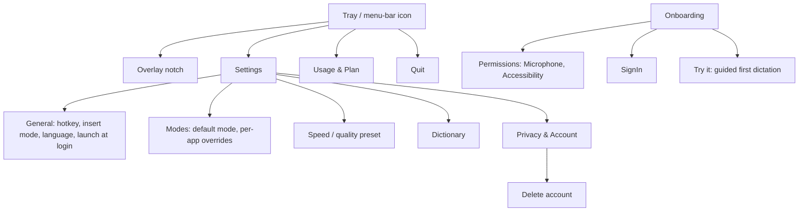
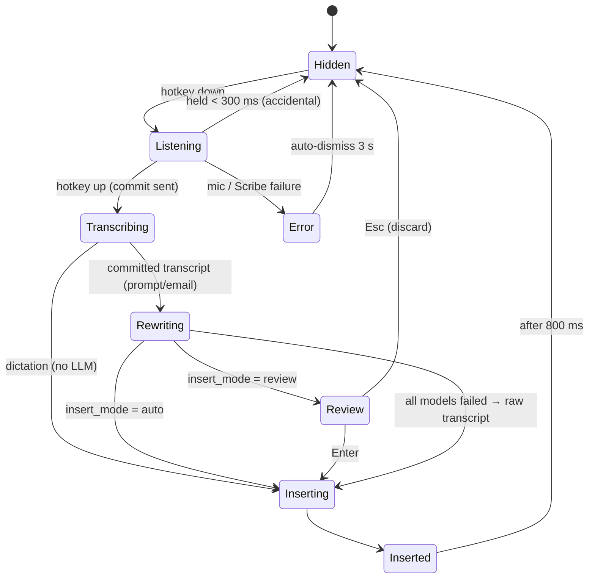

# Sayvox UI/UX Specification

> BMAD artifact · UX Expert output · v1.0 · 2026-11-24
> Inputs: `docs/prd.md` §3

## 1. Overall UX Goals & Principles

### Target personas
- **AI-heavy builder:** dictates long prompts into Cursor/ChatGPT/Claude; wants structure and speed.
- **Communicator:** dictates emails and Slack replies; wants tone and clean punctuation.

### Usability goals
1. First successful dictation within 2 minutes of install (incl. permissions).
2. Zero clicks per dictation in auto-insert mode.
3. User always knows the state: listening, thinking, inserted, or failed.
4. User never loses words (raw transcript fallback).

### Design principles
1. **Invisible until summoned** — no window steals focus from the target app.
2. **Show progress, not chrome** — waveform → partial text → streamed rewrite.
3. **Trust through transparency** — mode badge, privacy statement one click away.
4. **Native feel** — follow OS light/dark, system fonts, platform conventions.

## 2. Information Architecture

**Navigation:** tray menu → settings window with left sidebar (General, Modes, Preset, Dictionary, Usage & Plan, Privacy & Account).

## 3. User Flows

### 3.1 Onboarding
0. Install guide (website): how to pass the macOS "Open Anyway" and Windows SmartScreen "Run anyway" prompts, since installers aren't code-signed (ADR-007).
1. Welcome → Sign in (Identity Platform sign-in page in system browser — email or Google — deep link back `sayvox://auth`).
2. Microphone permission prompt (both OS).
3. macOS: Accessibility permission with a screenshot guide and "Open System Settings" button; app polls until granted.
4. Guided try: "Hold Ctrl+Shift and say: *Schedule the demo for Friday*" inside a practice text box.
5. Done → app lives in tray/menu bar.

**Edge cases:** permission denied → persistent banner in tray menu and overlay error state with "Fix" link; sign-in timeout → retry.

### 3.2 Dictate (core loop)

### 3.3 Change mode for an app
Settings → Modes → "Add app" (picker lists running apps) → choose mode. Overlay mode badge click cycles mode for the current press.

### 3.4 Quota reached
Overlay shows "Daily limit reached" + "Upgrade" (opens checkout in browser). Hotkey press continues to show this state until reset or upgrade.

### 3.5 Forced update / kill switch
Blocking small window: "Update required" with Update button; kill switch shows "Sayvox is temporarily paused" in tray and overlay.

## 4. Key Screens

### Overlay / notch
- Position: top-center (macOS, below notch/menu bar), top-center always-on-top on Windows; does not take focus.
- Size: 420 × 64 px collapsed, grows to max 420 × 240 px for preview text.
- Elements: mode badge (Dictation / Prompt / Email), live waveform, partial text (1–2 lines, fading), streamed result, status icon, hint ("Enter to insert · Esc to discard" in review mode).

### Settings — General
Hotkey (recorder control), Insert behaviour (Auto / Review before insert), Language (Auto, English, English-India, Hinglish), Launch at login, Microphone device picker.

### Settings — Modes
Default mode select; table of app overrides (App, Mode, remove). Built-in suggestions: Cursor/VS Code → Prompt, Gmail/Outlook → Email, Slack/Teams → Email/Slack.

### Settings — Preset
Three cards: Fastest, Balanced (recommended), Cheapest, each with a speed/cost hint; plan-restricted presets shown locked.

### Settings — Dictionary
Add term input, list with delete, counter `n / limit`.

### Usage & Plan
Minutes used today / this period with progress bars, plan name, Upgrade button.

### Privacy & Account
Plain-language statement: audio → ElevenLabs; text → selected LLM provider via OpenRouter; nothing stored by Sayvox. Sign out. Delete account (confirm dialog, typed confirmation).

## 5. Component Library
Minimal custom set: Button, Toggle, Select, SegmentedControl, HotkeyRecorder, Card, ProgressBar, Badge, Toast, Modal, Waveform. System font stack; 8 px spacing grid.

## 6. Accessibility
WCAG 2.2 AA for settings; contrast ≥ 4.5:1; full keyboard navigation; screen-reader labels; overlay status also announced via OS accessibility notification; respect reduced-motion (static waveform).

## 7. Responsiveness
Desktop only. Settings window min 720 × 480, resizable. Overlay scales with OS display scaling (1×–3×).

## 8. Animation
Overlay slide/fade 120 ms; waveform at 30 fps; token streaming without layout jump (fixed width, grows downward).

## 9. Performance
Overlay must appear within 50 ms of hotkey down; UI thread never blocks on network.
